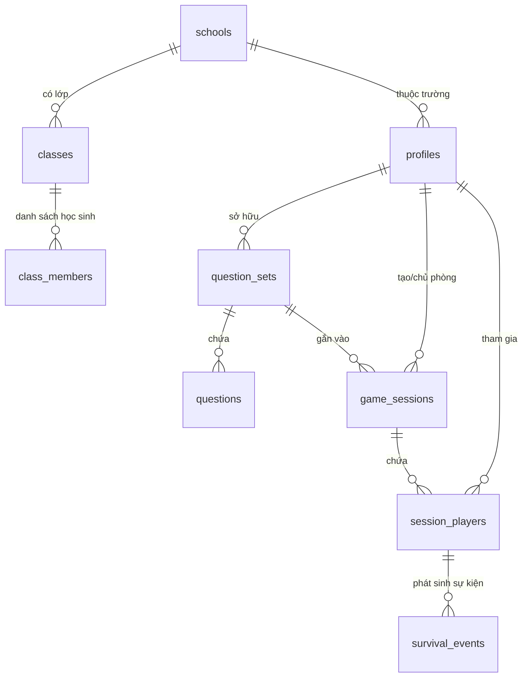

# 🗺️ BẢN ĐỒ ĐỊA HÌNH DỰ ÁN FOGGO (CODEBASE MAP)
> **Mục đích:** Tài liệu điều hướng tức thì cho lập trình viên và AI Agent. Mọi luồng đi, kiến trúc file, bảng cơ sở dữ liệu, phân quyền và cơ chế game đều được định vị sẵn tại đây — không cần dò tìm lại từ đầu.

---

## 1. TỔNG QUAN KIẾN TRÚC (TECH STACK)
- **Framework:** Next.js 16.4.5 (App Router, Turbopack, Server Actions)
- **React:** React 19.3.0
- **Ngôn ngữ:** TypeScript 5
- **Giao diện:** Tailwind CSS 4, Lucide React, Framer Motion
- **Backend / DB:** Supabase (PostgreSQL 15+, Supabase Auth, Row Level Security, Realtime)
- **Cơ chế tính điểm & Game Engine:** 100% Server-side (không để lộ đáp án hay logic chấm ở client)
- **Xử lý Excel:** `xlsx` (SheetJS) đọc/ghi tệp bảng tính `.xlsx`

---

## 2. BẢN ĐỒ ĐIỀU HƯỚNG ROUTE (PAGES & APIS)

| Đường dẫn (Route) | File thực thi | Quyền truy cập | Chức năng chính |
|---|---|---|---|
| `/` | `src/app/page.tsx` | Công khai | Landing page giới thiệu Foggo, CTA vào chơi |
| `/login` | `src/app/(auth)/login/page.tsx`, `AuthUnifiedClient.tsx` | Công khai | Hub xác thực hợp nhất 2 tab (Đăng nhập ⇋ Đăng ký), hỗ trợ chuyển ngữ VI/EN, ẩn Google OAuth & Quên mật khẩu |
| `/register` | `src/app/(auth)/register/page.tsx`, `AuthUnifiedClient.tsx` | Công khai | Tab Đăng ký tân thủ: Chọn Học sinh (không cần email) hoặc Giáo viên (cần email) |
| `/register/student` | `src/app/(auth)/register/student/page.tsx` | Công khai | Điểm vào trực tiếp đăng ký Học sinh trên nền Auth Hub hợp nhất |
| `/register/recovery-code` | `src/app/(auth)/register/recovery-code/page.tsx` | Công khai | Hiển thị và tải file mã khôi phục bí mật sau khi học sinh đăng ký |
| `/dashboard` | `src/app/dashboard/page.tsx`, `DashboardClient.tsx`, `actions.ts` | User đã đăng nhập | Phân quyền: Giáo viên quản trị bộ đề & phòng; Học sinh có Hub Thám Hiểm: Đổi tên hiển thị, Cập nhật Trường & Lớp, Bạn cùng lớp & cùng trường, Lịch sử làm bài chi tiết (tỉ lệ đúng/sai %, quái hạ, xu), Điểm danh 7 ngày, Bãi Farm Solo 24/7, Đấu trường Lớp, 4 ô trang bị |
| `/dashboard/sets` | `src/app/dashboard/sets/page.tsx`, `QuestionSetsClient.tsx`, `actions.ts` | Teacher, Admin | Quản lý kho bộ đề, Import/Export Excel, Xóa mềm an toàn vào Thùng rác (Trash Bin), Lịch sử xóa đề, Hoàn tác tức thì (Undo 1-click), Xóa vĩnh viễn không vướng Foreign Key |
| `/dashboard/sets/new` | `src/app/dashboard/sets/new/page.tsx` | Teacher, Admin | Khởi tạo nhanh bộ đề mới (tiêu đề, môn, lớp) |
| `/dashboard/sets/[id]/edit` | `src/app/dashboard/sets/[id]/edit/page.tsx` | Owner, Admin | Trình soạn thảo 8 dạng câu hỏi, Import Excel vào bộ đề, Tải file mẫu |
| `/dashboard/reports/[id]` | `src/app/dashboard/reports/[id]/page.tsx`, `ReportClient.tsx` | Teacher, Admin | Báo cáo chi tiết phòng chơi: xếp hạng học sinh, Phân tích tỉ lệ làm sai câu nào nhiều và bao nhiêu phần trăm (Top câu hỏi sai nhiều nhất), giải thích đáp án, xuất CSV |
| `/worlds` | `src/app/worlds/page.tsx` | All (phân quyền) | Danh sách hầm ngục đang quản lý & đảo đang tham gia, nút Solo Farm |
| `/teacher/worlds/new` | `src/app/teacher/worlds/new/page.tsx` | Teacher, Admin | Mở hầm ngục mới: chọn bộ đề, chọn đồ hiếm & tỉ lệ rớt (10-100%) |
| `/teacher/worlds/[id]` | `src/app/teacher/worlds/[id]/page.tsx` | Host, Admin | Bảng điều khiển thời gian thực: sương mù, khóa học sinh, bảng điểm |
| `/world/[id]` | `src/app/world/[id]/page.tsx`, `WorldClient.tsx`, `MonsterBattleArena.tsx` | Player | Màn hình sinh tồn tối giản cho học sinh: 4 tab trực quan (Săn Quái, Thợ Rèn, Túi Đồ 30 ô & Bán vật phẩm lấy xu, Bảng Xếp Hạng); Sàn đấu luyện tập bất tận (phản hồi siêu tốc, bảng xem lại kiến thức & đáp án đúng khi trả lời sai); hỗ trợ kéo thả ghép nối trực quan; xóa giới hạn khung câu hỏi danh sách thả xuống; ngôn từ chuẩn hóa chuyên nghiệp |
| `/explore` | `src/app/explore/page.tsx` | User đã đăng nhập | Khám phá kho đề cộng đồng, sao chép 1 chạm vào kho cá nhân |
| `/admin` | `src/app/admin/page.tsx`, `AdminClient.tsx`, `actions.ts` | Admin | Quản lý Học sinh & Giáo viên: hiển thị mật khẩu (`••••••••` ⇋ văn bản rõ, copy 1-click, modal đổi mật khẩu trực tiếp), phân quyền, cấp mã khôi phục, loại bỏ taskbar thừa |
| `/pricing` | `src/app/pricing/page.tsx` | Công khai | Bảng giá gói Foggo Plus giáo viên / trường học |
| `/j/[token]` | `src/app/j/[token]/page.tsx` | Công khai / Học sinh | Link vào chơi trực tiếp không cần mã PIN qua token |
| `API: /api/world/join` | `src/app/api/world/join/route.ts` | Endpoint | Xử lý học sinh/khách gia nhập phiên chơi bằng token |
| `API: /api/cron/check-expired` | `src/app/api/cron/check-expired/route.ts` | Cron / Webhook | Tự động hạ gói Plus khi hết hạn |

---

## 3. BẢN ĐỒ CƠ SỞ DỮ LIỆU (DATABASE TABLES & RELATIONS)

### Các bảng cốt lõi:
1. **`profiles`**:
   - `id` (uuid, PK, auth.uid)
   - `username` (text, duy nhất cho học sinh đăng ký không email)
   - `display_name` (text, tên hiển thị)
   - `role` (`'student'` \| `'teacher'` \| `'admin'`)
   - `plan` (`'free'` \| `'plus'`)
   - `fireflies` (int, Đom Đóm - tiền tệ ngoài ván lưu vĩnh viễn)
   - `recovery_code_hash` (text, hash bcrypt mã khôi phục học sinh)
2. **`question_sets`**:
   - `id` (uuid, PK)
   - `owner_id` (uuid -> profiles.id)
   - `title`, `description`, `subject`, `grade_level`
   - `visibility` (`'public'` \| `'unlisted'` \| `'private'`)
   - `play_count` (int)
3. **`questions`**:
   - `id` (uuid, PK)
   - `set_id` (uuid -> question_sets.id)
   - `position` (int, thứ tự câu hỏi)
   - `type` (1 trong 8 dạng câu hỏi, xem mục 5)
   - `content` (jsonb, đề bài, các phương án, ảnh minh họa)
   - `answer_key` (jsonb, đáp án đúng - BẢO MẬT, chỉ server đọc)
   - `time_limit_sec` (int, mặc định 20-30s)
   - `points` (int, mặc định 1000)
   - `explanation` (text, lời giải thích sau khi trả lời)
4. **`game_sessions`**:
   - `id` (uuid, PK)
   - `host_id` (uuid -> profiles.id)
   - `teacher_id` (uuid, backup quản lý)
   - `set_id` (uuid -> question_sets.id)
   - `kind` (`'class'` \| `'solo'` \| `'link'`)
   - `status` (`'open'` \| `'paused'` \| `'closed'`)
   - `settings` (jsonb: `dungeonDrops`, `dungeonDropRate`, `isClassDungeon`, `isHomeFarm`, `dailyPlayLimitMinutes`)
5. **`session_players`**:
   - `id` (uuid, PK)
   - `session_id` (uuid -> game_sessions.id)
   - `user_id` (uuid -> profiles.id)
   - `hp`, `max_hp`, `score`, `gold` (tiền vàng trong ván để mua đồ thợ rèn)
   - `inventory` (jsonb: danh sách slot vật phẩm, số lượng, độ bền)
   - `equipment` (jsonb: `{ weapon, armor, accessory }`)
   - `state` (jsonb: `{ hp, hunger, fogLevel, streak, day, phase }`)

---

## 4. BẢN ĐỒ AUTH VÀ PHÂN QUYỀN (AUTHENTICATION & ROLES)
- **Tệp điều phối trung tâm:** `src/lib/auth.ts`
- **Hàm `requireUser(roles?: UserRole[])`:**
  - Kiểm tra session đăng nhập qua cookie server.
  - Tự động nhận diện Superadmin qua email `hoaifongg@gmail.com` hoặc metadata `role=admin` và thăng cấp `admin` + gói `plus`.
  - Quản trị viên (``) tự động có toàn quyền như Giáo viên + Học sinh mà không bao giờ bị chặn 403 / redirect.
- **Tệp đăng nhập/đăng ký:**
  - `src/app/(auth)/actions.ts`: Đăng nhập (hỗ trợ cả username & email), Đăng xuất, Đăng ký GV.
  - `src/app/(auth)/student-actions.ts`: Đăng ký học sinh qua Admin API `admin.auth.admin.createUser`, gán domain nội bộ `@student.foggo.vn`, bypass email confirmation.
- **Biến môi trường (`.env.local`):**
  - `NEXT_PUBLIC_SUPABASE_URL`: Đường dẫn API Supabase.
  - `NEXT_PUBLIC_SUPABASE_ANON_KEY`: Khóa công khai cho client.
  - `SUPABASE_SERVICE_ROLE_KEY`: Khóa Secret quyền Admin tối cao (dùng ở server routes & student actions).

---

## 5. BẢN ĐỒ 9 DẠNG CÂU HỎI (QUESTION TYPES REGISTRY)
- **Thư mục gốc:** `src/question-types/`
- **Tệp đăng ký tổng:** `src/question-types/registry.ts`

| Loại (`type`) | Tên hiển thị | Thư mục định nghĩa | Cấu trúc `content` | Cấu trúc `answer_key` |
|---|---|---|---|---|
| `single_choice` | Trắc nghiệm 1 đáp án | `src/question-types/single-choice/` | `{ prompt, options: [{id, text}] }` | `{ correct: "opt_id" }` |
| `true_false` | Đúng / Sai | `src/question-types/true-false/` | `{ prompt, statements: [{id, text}] }` | `{ answers: { s1: true } }` |
| `multi_select` | Chọn nhiều đáp án đúng | `src/question-types/multi-select/` | `{ prompt, options: [{id, text}] }` | `{ correct: ["opt_1", "opt_3"] }` |
| `dropdown_list` | Lựa chọn từ danh sách | `src/question-types/dropdown-list/` | `{ prompt: "...{D}...", dropdowns: [{id, options}] }` | `{ answers: { d1: "Có" } }` |
| `drag_order` | Kéo thả sắp xếp thứ tự | `src/question-types/drag-order/` | `{ prompt, items: [{id, text}] }` | `{ order: ["id_1", "id_2", ...] }` |
| `drag_match` | Ghép cặp tương ứng | `src/question-types/drag-match/` | `{ prompt, pairs: [{left, right}] }` | `{ pairs: [...] }` |
| `drag_fill` | Kéo từ điền vào chỗ trống | `src/question-types/drag-fill/` | `{ template, words: [] }` | `{ blanks: { b1: "từ" } }` |
| `hotspot` | Điểm nóng trên hình ảnh | `src/question-types/hotspot/` | `{ image_url, regions: [] }` | `{ correct_region_id }` |
| `true_false_multi` | Nhiều mệnh đề Đúng/Sai | `src/question-types/true-false/` (alias) | `{ prompt, statements }` | `{ answers: { s1: true } }` |

---

## 6. BẢN ĐỒ GAME ENGINE SINH TỒN (SURVIVAL ENGINE)
- **Thư mục:** `src/game-modes/survival/`
- **Tệp cốt lõi:**
  - `engine.ts`: Các hàm thuần cập nhật trạng thái game (`tick`, `applyHunt`, `applyFlee`, `applyGather`, `applyExplore`, `applyCraft`, `applyBlacksmithBuy`, `applyNightDefense`, `applyRevive`, `applyRespawn`). Bảo lưu 100% xu của người chơi khi ngất xỉu.
  - `items.ts`: Toàn bộ từ điển vật phẩm (`ITEM_REGISTRY`), vũ khí, giáp, thuốc, và danh sách báu vật hiếm hầm ngục (`DUNGEON_RARE_ITEMS`).
  - `config.ts`: Cân bằng chỉ số thân thiện tân thủ (Slime 20 HP, 3 ATK), đói giảm chậm, bảo lưu 100% xu khi chết (`DEATH_GOLD_KEEP_RATIO: 1.0`).
  - `clock.ts`: Tính toán pha ngày/đêm và ngày thứ mấy dựa trên thời gian thực.
  - `monsters.ts`: Từ điển quái vật theo khu vực, hàm `getRandomFarmMonster()` xuất hiện quái ngẫu nhiên liên hoàn.
  - `src/app/world/[id]/MonsterBattleArena.tsx`: Đấu trường 2D RPG Single-Screen Viewport (`h-screen overflow-hidden`, không cần cuộn dọc) — sân đấu quái nhỏ gọn phía trên (180px–210px), hoạt họa nhân vật & Sprite Slime 8 frames, câu hỏi & đáp án 2 cột dàn trải đều bên dưới, nút vung kiếm kèm phím tắt Enter, hiển thị Xu an toàn (`Number.isFinite`) và popup cấp cứu sinh lực khi hết máu (mua bình máu 10 xu, dùng item túi đồ, hồi sinh trại miễn phí).
  - `src/components/DailyLoginStreakCard.tsx`: Bảng điểm danh đăng nhập 7 ngày nhận quà liên tiếp trên Dashboard học sinh; cấu hình phần thưởng tách biệt tại `src/lib/daily-rewards-config.ts`, server action tại `src/app/dashboard/actions.ts`.

### Quy luật 2 chế độ (Class Dungeon vs Home Farm):
1. **Hầm ngục lớp (`isClassDungeon = true`):**
   - GV chọn danh sách đồ rơi hiếm (`dungeonDrops`) và chỉnh tỉ lệ (`dungeonDropRate`).
   - Săn quái rớt đồ hiếm theo xác suất do GV định trước.
   - Bảng xếp hạng và sự kiện chung toàn lớp.
2. **Farm quái tại nhà (`isHomeFarm = true`, `kind = 'solo'`):**
   - Tự động lấy ngẫu nhiên câu hỏi từ Giáo viên của Lớp và Trường học sinh đang theo học (`profiles.class_id`, `profiles.school_id`).
   - Săn quái theo lượt (Turn-based RPG): Trả lời đúng -> Tấn công quái. Nếu quái chưa chết -> Quái phản công học sinh (sát thương được giảm nhờ Mũ, Giáp, Khiên tối đa 60%).
   - Học sinh cày Vàng và Đom Đóm khi GV chưa mở phòng lớp.
   - Tiêu Vàng tại Thợ Rèn & Tiệm Đồ để sắm Kiếm, Mũ, Giáp Sắt, Khiên và Nhu yếu phẩm/Thuốc.
   - Vàng và Trang bị lưu vĩnh viễn mang vào Hầm ngục lớp học.

### Chỉ số cân bằng RPG & Chống lạm phát (Game Balance):
- **Nhân vật:** HP: 100, Đói: 100, ATK cơ bản (tay không): 8, Vàng khởi đầu: 30 xu.
- **4 Ô Trang Bị (`EquippedGear`):**
  - ⚔️ **Vũ khí (`weapon`):** Gậy gỗ (+4 ATK), Kiếm gỗ (+6 ATK), Kiếm đá (+10 ATK), Kiếm sắt (+15 ATK). Có thể cường hóa +4 ATK/cấp.
  - 🪖 **Mũ (`helmet`):** Mũ rơm (-3% ST), Mũ da (-6% ST), Mũ sắt (-10% ST).
  - 🛡️ **Giáp (`armor`):** Áo vải (-5% ST), Giáp da (-10% ST), Giáp sắt (-18% ST).
  - 🛡️ **Khiên (`shield`):** Khiên gỗ (-6% ST), Khiên sắt (-12% ST).
  *(Tổng phòng thủ Giáp + Mũ + Khiên tối đa 60% giảm sát thương, giữ nguyên độ kịch tính khi săn quái).*
- **Nhu yếu phẩm & Thức ăn:** Táo (+15 đói, +3 HP), Bánh mì (+30 đói, +6 HP), Thịt nướng (+45 đói, +12 HP), Băng gạc (+25 HP), Bình máu nhỏ (+40 HP), Bình máu lớn (+75 HP).
- **Quái vật cơ bản (Forest):**
  - `slime` (30 HP, 5 ATK, 3-6 xu)
  - `baby_wolf` (40 HP, 6 ATK, 5-8 xu)
  - `wolf` (55 HP, 8 ATK, 7-12 xu)
  - `mist_spider` (48 HP, 10 ATK, 7-12 xu)
  - `wild_boar` (65 HP, 9 ATK, 8-14 xu)
  - `forest_goblin` (80 HP, 12 ATK, 12-18 xu)
  - Boss `boar_king` (200 HP, 16 ATK, 70-110 xu)

---

## 7. BẢN ĐỒ CHỨC NĂNG SAO LƯU & NHẬP XUẤT CÂU HỎI (EXCEL IMPORT/EXPORT)
- **Xử lý Excel:** `src/lib/excel/`
  - `template.ts`: Tạo file mẫu Excel chuẩn `.xlsx` (kèm hướng dẫn, tô màu header, câu mẫu có sẵn).
  - `importer.ts`: Đọc file Excel từ giáo viên tải lên, phân tích cú pháp, tự động nhận diện dạng câu hỏi và chuẩn hóa schema.
  - `exporter.ts`: Xuất bộ câu hỏi ra file `.xlsx` hoặc `.json` sao lưu an toàn.
- **Giao diện tích hợp:**
  - `src/app/dashboard/sets/page.tsx`: Nút "Tải file mẫu Excel", "Nhập đề từ Excel", "Sao lưu bộ đề".
  - `src/app/dashboard/sets/[id]/edit/QuestionSetEditorClient.tsx`:
    - Thanh cuộn độc lập cho danh sách câu hỏi bên trái (`overflow-y-auto`, không kéo dài màn hình).
    - Bảo lưu 100% nội dung câu hỏi (`prompt`), hình ảnh và phương án/mệnh đề tương thích khi người dùng chuyển đổi dạng câu hỏi (`handleChangeType`).

---

## 8. NGUYÊN TẮC VÀ LỐI TẮT BẢO TRÌ NHANH
1. **Sửa giao diện / thanh Header:** vào thẳng [`src/components/NavigationHeader.tsx`](file:///d:/Project/Foggo/src/components/NavigationHeader.tsx).
2. **Sửa trang quản trị Admin:** vào thẳng [`src/app/admin/AdminClient.tsx`](file:///d:/Project/Foggo/src/app/admin/AdminClient.tsx).
3. **Sửa trang tạo hầm ngục mới:** vào thẳng [`src/app/teacher/worlds/new/NewWorldClient.tsx`](file:///d:/Project/Foggo/src/app/teacher/worlds/new/NewWorldClient.tsx).
4. **Sửa trang Dashboard:** vào thẳng [`src/app/dashboard/page.tsx`](file:///d:/Project/Foggo/src/app/dashboard/page.tsx).
5. **Thêm vật phẩm hoặc chỉnh tỉ lệ rơi:** vào [`src/game-modes/survival/items.ts`](file:///d:/Project/Foggo/src/game-modes/survival/items.ts) và [`engine.ts`](file:///d:/Project/Foggo/src/game-modes/survival/engine.ts).
6. **Bảo mật cơ sở dữ liệu & RLS:** Khi thao tác server actions liên quan đến `session_players`, `game_sessions`, sử dụng `createAdminClient()` từ `@/lib/supabase/admin` để tránh lỗi `new row violates row-level security policy for table "session_players"`.
7. **Kiểm thử logic:** chạy lệnh `npm test` (kiểm tra 52 bài unit test của game engine và chấm điểm).
8. **Kiểm tra biên dịch:** chạy lệnh `npm run build` (kiểm tra toàn bộ 21 trang và TypeScript).
9. **Đấu trường săn quái 2D & Bố cục Single-screen:** Xem [`src/app/world/[id]/MonsterBattleArena.tsx`](file:///d:/Project/Foggo/src/app/world/[id]/MonsterBattleArena.tsx) - gom trọn sân đấu quái và bảng câu hỏi trong `h-screen overflow-hidden`, hiển thị Xu an toàn bằng `Number.isFinite(...)` không gây lỗi `NaN`.
10. **Cấu hình Đăng nhập 7 ngày nhận quà:** Đặt tại [`src/lib/daily-rewards-config.ts`](file:///d:/Project/Foggo/src/lib/daily-rewards-config.ts) (không để trong file `"use server"` để tránh lỗi Turbopack `DAILY_REWARDS_CONFIG.map is not a function`).
11. **Tối giản trải nghiệm học sinh (UX Streamlining):** Toàn bộ giao diện học sinh được tinh gọn: thanh Header chỉ hiện 2 tab cần thiết (Tổng quan, Hầm ngục); Dashboard hiển thị ngay Trường/Lớp, Vàng, Điểm Thành Tích, Điểm danh 7 ngày và 2 nút chơi lớn; Màn chơi thế giới chỉ giữ 4 tab RPG quan trọng (Săn Quái, Thợ Rèn, Túi Đồ, Bảng Xếp Hạng), lược bỏ toàn bộ cơ chế hái lượm cành cây và chế lửa rườm rà.
12. **Tiêu chuẩn thiết kế giao diện chuyên nghiệp (Google / Big Tech + Retro Pixel Art):** Tích hợp tiện ích CSS `.pixelated`, `.pixel-card`, `.glow-amber/emerald/blue` tại `src/app/globals.css`. Nâng cấp toàn diện Landing Page (`src/app/page.tsx`) với mockup sân đấu RPG trực quan sống động (nhân vật thám hiểm, pixel slime sprite, streak bonus, mẫu câu trắc nghiệm); Nâng cấp thanh Navigation Header (`src/components/NavigationHeader.tsx`) chuẩn SaaS hiện đại với pill tabs, avatar chip, role indicator dot; Nâng cấp thẻ điểm danh 7 ngày (`DailyLoginStreakCard.tsx`) với thanh tiến độ tuần và hiệu ứng rương VIP ngày 7; Nâng cấp bảng xếp hạng vinh danh với huy chương 🥇 Top 1, 🥈 Top 2, 🥉 Top 3 và thẻ săn quái bounty cards trong `WorldClient.tsx`.
13. **Tài khoản kiểm thử thực chiến (Test Accounts):** Toàn bộ thông tin tài khoản Học sinh (`hocsinh_test` / `TestPassword123!`) và Giáo viên (`giaovien_test@foggo.vn` / `TestPassword123!`) được lưu trữ vĩnh viễn tại [`TEST_ACCOUNTS.md`](file:///d:/Project/Foggo/TEST_ACCOUNTS.md). Kịch bản tự động kiểm thử gameplay và đồng bộ DB: `npx tsx scripts/test-account-runner.ts`.
14. **Khắc phục truy vấn liên kết PostgREST trong Bảng Quản Trị Admin (`/admin`):** Bảng `profiles` có 2 khóa ngoại trỏ tới bảng `schools` (`school_id` và `schools.created_by`). Do đó truy vấn Supabase bắt buộc phải chỉ định rõ tên cột khóa ngoại: `.select("*, schools:school_id(name), classes:class_id(name)")` tại [`src/app/admin/page.tsx`](file:///d:/Project/Foggo/src/app/admin/page.tsx) để tránh lỗi `PGRST201 (Could not embed because more than one relationship was found)`, giúp toàn bộ danh sách Giáo viên, Học sinh và Trường học hiển thị đầy đủ, chính xác.
15. **Bộ công cụ kiểm thử toàn diện hệ thống (Full System Automated Suite):**
    - `npx tsx scripts/full-system-test.ts`: Kiểm tra tự động 31 bài test tích hợp phủ khắp 6 tầng hệ thống (HTTP Routes, Auth & RBAC, Điểm danh 7 ngày, Question Engine 8 dạng câu hỏi, Sinh tồn & Đấu trường Săn Quái Bất Tận, Admin Dashboard).
    - `npx tsx scripts/test-account-runner.ts`: Mô phỏng luồng đăng nhập học sinh thực tế, vào solo farm, săn quái, ghé thợ rèn mua & mặc trang bị, đồng bộ DB Supabase.
    - `npm test`: Kiểm tra 52 bài unit test logic thuật toán game engine và chấm điểm.
16. **Kiến trúc Bảo mật, Xác thực & Duy trì Phiên Đăng nhập (Security Architecture):**
    - **Duy trì phiên liên tục (Session Retention):** Sử dụng `@supabase/ssr` trong `src/middleware.ts` và `src/lib/supabase/server.ts`. Hàm `supabase.auth.getUser()` tự động xác thực chữ ký JWT với máy chủ và tự động đổi `refresh_token` lấy `access_token` mới trong cookie khi token cũ hết hạn (người chơi không bao giờ bị văng khi đang làm bài).
    - **Bảo vệ mã khôi phục học sinh:** Mã bí mật sinh ngẫu nhiên `randomBytes(12)` không chứa ký tự dễ nhầm lẫn (`0/O`, `1/I`), chỉ lưu bản băm SHA-256 (`recovery_code_hash`) trong cơ sở dữ liệu. Hàm so sánh dùng `timingSafeEqual` chống tấn công đo thời gian (Timing Attack). Khi khôi phục mật khẩu thành công, mã cũ tự động bị hủy và sinh mã mới.
    - **Chống gian lận lộ đáp án:** Client học sinh chỉ nhận `id, type, content, points` (tuyệt đối không chọn `answer_key`). Chấm điểm 100% tại Server Action (`src/app/world/[id]/actions.ts`).
    - **Chống leo thang đặc quyền (Privilege Escalation):** Loại bỏ việc tin cậy `user.user_metadata?.role` tại client; chỉ cấp quyền SuperAdmin cho email hệ thống (`hoaifongg@gmail.com`) hoặc `app_metadata` bảo mật; thêm `/admin` vào `PROTECTED` middleware; thiết lập trigger `trg_protect_profile_system_fields` tại PostgreSQL để ngăn chặn người dùng thường tự ý sửa `role`, `plan`, `fireflies`.
17. **Hệ Thống Hiệu Ứng Loading Bé Slime Siêu Dễ Thương & Tắt Chữ N:**
    - **Tắt biểu tượng chữ 'N' góc dưới bên trái:** Cấu hình `devIndicators: false` trong [`next.config.ts`](file:///d:/Project/Foggo/next.config.ts) kết hợp quy tắc ẩn triệt để CSS trong [`src/app/globals.css`](file:///d:/Project/Foggo/src/app/globals.css) (`[data-nextjs-toast]`, `[data-nextjs-dev-tools-button]`, `[data-next-badge]`, `nextjs-portal`, `button[aria-label="Next.js Dev Tools"]`).
    - **Bé Slime nhún nhảy siêu dễ thương ([`src/components/ui/CuteSlimeLoading.tsx`](file:///d:/Project/Foggo/src/components/ui/CuteSlimeLoading.tsx)):** Đầy đủ hoạt họa squishy bounce (`animate-slime-bounce`), bóng đổ co giãn theo nhịp (`animate-slime-shadow`), đom đóm lơ lửng (`animate-firefly-drift`), bóng thoại xoay vòng các câu nói đáng yêu (`( ´｡• ᵕ •｡` )`) và thanh tiến trình pixel retro phát sáng.
    - **Thanh Progress Bar laser đỉnh màn hình:** [`src/components/NavigationProgressBar.tsx`](file:///d:/Project/Foggo/src/components/NavigationProgressBar.tsx) phản hồi ngay 0ms khi click link, chạy tia laser gradient và pill *"Bé Slime đang mở đường... ✨"*.
    - **Tích hợp toàn diện:** [`src/app/loading.tsx`](file:///d:/Project/Foggo/src/app/loading.tsx), [`src/app/world/[id]/loading.tsx`](file:///d:/Project/Foggo/src/app/world/[id]/loading.tsx), [`src/app/dashboard/loading.tsx`](file:///d:/Project/Foggo/src/app/dashboard/loading.tsx) và [`src/components/ui/LoadingOverlay.tsx`](file:///d:/Project/Foggo/src/components/ui/LoadingOverlay.tsx).
18. **Hệ Thống Đa Ngôn Ngữ Song Ngữ (Bilingual i18n - Tiếng Việt 🇻🇳 & English 🇬🇧):**
    - **Kiến trúc:** [`src/lib/i18n/`](file:///d:/Project/Foggo/src/lib/i18n/)
      - [`types.ts`](file:///d:/Project/Foggo/src/lib/i18n/types.ts): Định nghĩa kiểu `Language = "vi" | "en"` và schema dịch thuật `Translations` chặt chẽ (`common`, `nav`, `landing`, `dashboard`, `battle`, `slime`, `worlds`, `sets`, `questionTypes`, `monsters`, `auth`, `pricing`).
      - [`vi.ts`](file:///d:/Project/Foggo/src/lib/i18n/vi.ts): Bộ từ điển Tiếng Việt chuẩn phong cách học tập sinh tồn sương mù Foggo.
      - [`en.ts`](file:///d:/Project/Foggo/src/lib/i18n/en.ts): Bộ từ điển Tiếng Anh chuyên nghiệp, tự nhiên chuẩn quốc tế.
      - [`useLanguage.ts`](file:///d:/Project/Foggo/src/lib/i18n/useLanguage.ts): Reactive Zustand store với middleware `persist` lưu `localStorage` (`foggo_user_language`) và đồng bộ `document.cookie` (`foggo_lang`), cung cấp hook `useLanguage()` (`t`, `language`, `setLanguage`, `toggleLanguage`, `isVi`, `isEn`).
      - [`questions-translation.ts`](file:///d:/Project/Foggo/src/lib/i18n/questions-translation.ts): **Engine dịch thuật động Ngân hàng câu hỏi & Thuật toán dịch tự động đệ quy:**
        - Cung cấp hàm `localizeQuestionContent(content, language)`, `localizeQuestion(question, language)` và `localizeQuestionSet(set, language)`.
        - **Thuật toán tự động dịch thuật đệ quy (`autoTranslateViToEn`):** Khi giáo viên soạn bất kỳ đề thi tiếng Việt tùy ý (không có sẵn trong từ điển tĩnh), hệ thống tự động phân tích ngữ pháp câu hỏi, mẫu câu trắc nghiệm (Đâu là, Cái nào sau đây, Ai là, Khi nào, Chọn đáp án đúng nhất...) và tra cứu bộ từ điển giáo dục 500+ thuật ngữ Tin học, Toán học, Khoa học, Địa lý, từ nối và liên từ để dịch toàn bộ đề bài, phương án lựa chọn, mệnh đề và ô trống sang tiếng Anh tự nhiên.
        - **Bảo toàn 100% ID và Logic chấm điểm:** Giữ nguyên vẹn toàn bộ ID của option (`opt_1`, `opt_2`), statement (`s1`, `s2`), pair (`p1`, `p2`), giúp việc gửi đáp án lên server action và so khớp với `answer_key` luôn chính xác tuyệt đối mà không cần can thiệp logic chấm điểm server.
        - Unit test bảo vệ: `src/lib/i18n/questions-translation.test.ts` (56/56 unit tests pass, kiểm tra tính toàn vẹn 2 chiều Tiếng Việt ⇋ Tiếng Anh và dịch thuật tự động).
      - [`game-translations.ts`](file:///d:/Project/Foggo/src/lib/i18n/game-translations.ts): Từ điển thực thể RPG song ngữ: Dịch toàn bộ tên và mô tả của quái vật (`localizeMonsterDef`), trang bị vũ khí/giáp/mũ/khiên/thức ăn (`localizeItemDef`) và tiêu đề phòng chơi (`localizeWorldTitle`).
    - **Nút chuyển đổi ngôn ngữ (Language Switcher):**
      - [`src/components/LanguageSwitcher.tsx`](file:///d:/Project/Foggo/src/components/LanguageSwitcher.tsx): Nút bấm dạng pill nhỏ gọn, hiển thị cờ và mã ngôn ngữ (`🇻🇳 VI` ⇋ `🇬🇧 EN`), hiệu ứng viền sáng amber, chuyển đổi tức thì 0ms không cần reload trang. Nhúng trực tiếp tại NavigationHeader và Header thế giới chơi.
    - **Tích hợp toàn diện trên toàn bộ hệ thống:**
      - [`src/components/NavigationHeader.tsx`](file:///d:/Project/Foggo/src/components/NavigationHeader.tsx): Tích hợp đa ngôn ngữ toàn bộ thanh điều hướng, vai trò người dùng, tooltip đăng xuất và nhúng `LanguageSwitcher`.
      - [`src/app/LandingClient.tsx`](file:///d:/Project/Foggo/src/app/LandingClient.tsx) & [`src/app/page.tsx`](file:///d:/Project/Foggo/src/app/page.tsx): Toàn bộ trang chủ phản ứng chuyển ngữ tức thì.
      - [`src/app/dashboard/DashboardClient.tsx`](file:///d:/Project/Foggo/src/app/dashboard/DashboardClient.tsx): Chuyển ngữ toàn bộ bảng điều khiển cho Giáo viên, Admin và Học sinh (thẻ chào mừng, bãi farm 24/7, đấu trường lớp, trang bị và lịch sử).
      - [`src/app/world/[id]/WorldClient.tsx`](file:///d:/Project/Foggo/src/app/world/[id]/WorldClient.tsx): Tích hợp `LanguageSwitcher` trên thanh header, chuyển ngữ tiêu đề phòng chơi, toàn bộ 4 tab sinh tồn RPG (Săn Quái, Thợ Rèn & Tiệm Đồ, Túi Đồ, Bảng Xếp Hạng), thông tin quái vật, thẻ trang bị, danh mục cửa hàng và modal câu hỏi làm bài.
      - [`src/app/world/[id]/MonsterBattleArena.tsx`](file:///d:/Project/Foggo/src/app/world/[id]/MonsterBattleArena.tsx): Toàn bộ giao diện đấu trường săn quái: tên quái vật, câu hỏi, phương án lựa chọn, nút hành động, thông báo hạ quái, chữ sát thương bay, modal rút lui và modal ngã gục đều tự động dịch theo ngôn ngữ người chơi chọn.
      - [`src/app/dashboard/sets/QuestionSetsClient.tsx`](file:///d:/Project/Foggo/src/app/dashboard/sets/QuestionSetsClient.tsx): Danh sách bộ đề, phân loại môn học và số lượng câu hỏi.
      - [`src/app/dashboard/sets/[id]/edit/QuestionSetEditorClient.tsx`](file:///d:/Project/Foggo/src/app/dashboard/sets/[id]/edit/QuestionSetEditorClient.tsx): Trình soạn thảo câu hỏi, danh sách câu hỏi thanh bên và huy hiệu loại câu hỏi.
      - [`src/app/worlds/WorldsClient.tsx`](file:///d:/Project/Foggo/src/app/worlds/WorldsClient.tsx): Danh sách hầm ngục và thế giới đang mở.
      - [`src/app/explore/ExploreClient.tsx`](file:///d:/Project/Foggo/src/app/explore/ExploreClient.tsx): Thư viện khám phá cộng đồng.
      - [`src/app/pricing/PricingClient.tsx`](file:///d:/Project/Foggo/src/app/pricing/PricingClient.tsx): Bảng giá các gói dịch vụ.
      - Bộ components hiển thị câu hỏi [`src/question-types/*/Player.tsx`](file:///d:/Project/Foggo/src/question-types/): Toàn bộ huy hiệu loại câu hỏi, hướng dẫn thao tác và nút bấm ĐÚNG / SAI tự động chuyển đổi theo ngôn ngữ người dùng.
      - [`scripts/seed-english-set.ts`](file:///d:/Project/Foggo/scripts/seed-english-set.ts): Bộ câu hỏi mẫu tiếng Anh chuẩn quốc tế ("Grade 7 CS & Digital Literacy (English)") được lưu trữ trực tiếp trong cơ sở dữ liệu Supabase với cờ `language: 'en'`.
      - [`src/components/ui/CuteSlimeLoading.tsx`](file:///d:/Project/Foggo/src/components/ui/CuteSlimeLoading.tsx): Bóng thoại Bé Slime chuyển đổi câu thoại siêu dễ thương theo ngôn ngữ đã chọn.
19. **Khắc Phục Lỗi Quái 1000+ Máu (Monster Scaling Bug) & Tối Ưu Độ Trễ Phản Hồi:**
    - **Cơ chế lỗi cũ:** `elapsed = nowSec - lastTickTimestamp` trong `engine.ts:tick()` dồn hàng ngàn giây khi học sinh offline lâu ngày, dẫn đến ngày chơi ảo nhảy lên `Day 387+` và công thức scale quái vật đẩy máu Slime lên 1.052 HP và công lên 124 ATK (1-hit kill).
    - **3 tầng phòng thủ chống lỗi:**
      1. `engine.ts:tick()`: Chặn `elapsed = Math.min(rawElapsed, 60)` và `hungerLoss = Math.min(10, ...)` chống dồn ngày và ngất xỉu khi offline.
      2. `monsters.ts:getScaledMonster()`: Giới hạn ngày tính toán `safeDay = Math.min(Math.max(1, dayNumber), 5)`, áp trần cứng Slime max 30 HP, 5 ATK; quái thường max 80 HP, 12 ATK; boss max 300 HP, 25 ATK.
      3. `page.tsx` & `WorldClient.tsx`: Tự động khôi phục `playSec: Math.min(playSec, 480)` và `hp: 100` khi người chơi tải màn hình bãi farm.
    - **Tối ưu tốc độ phản hồi:** Dùng `adminClient` bỏ qua RLS overhead, ghi `survival_events` ở chế độ ngầm (`void Promise.resolve(...).catch(...)`), song song hóa `Promise.all` và rút ngắn hoạt họa turn-based chiến đấu (`MonsterBattleArena.tsx`) từ 1.400ms xuống dưới 350ms.
20. **Trung Tâm Cài Đặt Cá Nhân Bánh Răng (Personal Settings Gear & Modal):**
    - [`src/components/UserSettingsModal.tsx`](file:///d:/Project/Foggo/src/components/UserSettingsModal.tsx): Modal hợp nhất toàn bộ tùy chọn cá nhân trong một giao diện duy nhất, chia thành 4 tab:
      1. **Hồ Sơ (Profile):** Hiển thị avatar, vai trò, tên đăng nhập/email, form cập nhật Tên hiển thị (`updateStudentDisplayName`).
      2. **Trường & Lớp (School & Class):** Chọn tỉnh/thành phố từ [`src/lib/constants/provinces.ts`](file:///d:/Project/Foggo/src/lib/constants/provinces.ts), nhập trường học và lớp học (`updateStudentSchoolClass`).
      3. **Bảo Mật & Mật Khẩu (Security):** Đổi mật khẩu tài khoản trực tiếp (`updateOwnPassword`), tra cứu mã khôi phục bí mật của học sinh kèm nút sao chép và tải file sao lưu `.txt`.
      4. **Tùy Chọn & Hệ Thống (Preferences):** Chuyển đổi ngôn ngữ hiển thị (VI / EN), xem số dư Đom Đóm / Vàng và nút Đăng xuất an toàn.
    - **Điểm truy cập toàn cục:** Nút Bánh răng (`Settings` icon) được nhúng ngay cạnh avatar tại [`NavigationHeader.tsx`](file:///d:/Project/Foggo/src/components/NavigationHeader.tsx) (truy cập từ mọi trang) và nút Bánh răng cài đặt nổi bật tại Hero Profile Card [`DashboardClient.tsx`](file:///d:/Project/Foggo/src/app/dashboard/DashboardClient.tsx), xóa bỏ triệt để các nút chỉnh sửa phân tán trước đây.
21. **Hệ Thống Thùng Rác (Trash Bin) & Hoàn Tác Đề Thi (Undo) + Sinh Vật Ambient Tương Tác:**
    - **Sửa Lỗi Xóa Bộ Đề & Cơ Chế Soft Delete:**
      - Khắc phục triệt để lỗi vi phạm ràng buộc Foreign Key Postgres `game_sessions_set_id_fkey` khi xóa bộ đề đã từng được chơi/tạo phòng.
      - Chuyển thao tác xóa mặc định sang **Soft Delete** an toàn: gắn tag `[DELETED:epochTimestamp:originalVisibility]`, đưa vào Thùng rác và bảo lưu 100% câu hỏi.
      - **Hoàn tác (Restore 1-click):** Khôi phục tức thì bộ đề về trạng thái hoạt động với đầy đủ quyền hiển thị (`public`, `unlisted`, `private`) và dữ liệu gốc.
      - **Xóa vĩnh viễn (Permanent Delete):** Gỡ liên kết `game_sessions.set_id = null` an toàn trước khi xóa cascading câu hỏi và bản ghi bộ đề trong DB.
      - **Giao diện Quản lý Thùng rác (`QuestionSetsClient.tsx`):** Nút truy cập Thùng rác có badge đếm số lượng, thanh tìm kiếm lọc đề đã xóa, hộp thoại xác nhận cảnh báo an toàn và Floating Toast hoàn tác tức thì.
    - **Thiết Kế Nền Sang Trọng & Sinh Vật Ambient (`AmbientCreatures.tsx`):**
      - Nâng cấp dải màu nền đa tầng: Gradient Amber ấm áp kết hợp hào quang Sapphire/Indigo và viền gương phản chiếu ánh sáng Apple Glass.
      - Sinh vật tương tác (`AmbientCreatures.tsx`): Bé Slime (`/sprites/slime_...`), Bé Cáo Foggo (`🦊🎒`) và Tinh linh ánh sáng lượn qua nền mỗi 20–35s, phản hồi khi người dùng bấm vào (bắn sao lấp lánh `✨`, hiện bong bóng lời thoại động viên, nhảy nhót vui nhộn). Tích hợp cơ chế không cản trở click (`pointer-events-none`) và tôn trọng `prefers-reduced-motion`.
    - **Kiểm định hoàn hảo:** `npm test` đạt **65/65 unit tests (100%)**, `scripts/full-system-test.ts` đạt **31/31 integration tests (100%)**.
22. **Hệ Thống Sprite Đồ Họa Quái Vật 8 Khung Hình & Animation Mượt Mà (`MonsterBattleArena.tsx`):**
    - **6 Loại Quái Vật Có Sprite Sheet Riêng Biệt (6 Custom Animated Monsters):**
      1. **Slime Xanh (`slime`)**: Sơ cấp, dạng khối thạch nhấp nhô.
      2. **Sói Con Rừng Sương (`baby_wolf` / `wolf`)**: 8 khung hình (Idle, Chuẩn bị chạy, Chạy, Nhảy, Tiếp đất, Bị thương, Nằm xuống, Ngồi chờ).
      3. **Nhện Độc Sương Mù (`mist_spider`)**: 8 khung hình (Idle, Bò, Tấn công, Phun sương độc, Bị choáng, Bị đánh bại, Tan biến, Sương độc còn sót lại).
      4. **Heo Rừng Chúa (`boar_king` / `wild_boar`)**: 8 khung hình (Idle uy nghi, Đi tuần, Lao tới, Gầm thét, Húc mạnh, Choáng váng, Bị đánh bại, Tan biến để lại vương miện).
      5. **Yêu Tinh Rừng Goblin (`forest_goblin` / `goblin`)**: 8 khung hình (Idle, Đi bộ, Chạy, Nhảy, Vui vẻ khích tướng, Tức giận, Ngủ gục, Ngồi nghỉ). Tách nền đen thành PNG trong suốt.
      6. **Golem Nhỏ & Golem Đá Khổng Lồ (`small_golem` / `rock_golem`)**: 8 khung hình (Idle mắt pha lê, Bò nhô lên, Tấn công vung đấm, Phun khói đá độc, Bị choáng rạn nứt, Đổ gục vỡ vụn, Tan biến khói bụi, Tàn tích sỏi đá).
      7. **Bộ Xương Cổ Đại (`skeleton`)**: 8 khung hình (Idle cầm kiếm rỉ, Bò rình mồi, Giương kiếm, Chém kiếm trăng khuyết tím uy lực, Bị choáng lung lay, Bị đánh bại, Tan biến linh hồn tím, Đống tro tàn sót lại).
    - **Cân Chỉnh Hướng Mặt Đối Kháng Trực Diện (Face-to-Face Alignment):**
      - Hiệp sĩ đứng ở bên TRÁI hướng sang phải (`-->`).
      - Toàn bộ quái vật ở bên PHẢI đều được căn chỉnh/lật gương (`flipHorizontal`) để hướng sang TRÁI (`<--`), mắt đối mắt trực diện với Hiệp sĩ, xóa bỏ tình trạng quái vật quay lưng ra ngoài sân đấu.
    - **Hoạt Họa 5 Giai Đoạn Mượt Mà Không Khựng (5-Phase Fluid Combat Flow):**
      - Tối ưu nhịp thở Idle thành chu kỳ 380ms mượt mà kết hợp hiệu ứng thở Apple fluid breathing.
      - Phản công và tấn công chia chuẩn 5 giai đoạn: Lấy đà (140ms) -> Lướt tới (180ms với `cubic-bezier(0.2, 0.8, 0.2, 1)`) -> Va chạm & chớp sáng (180ms) -> Tiếp đất (180ms) -> Hồi chiêu êm ái (180ms), triệt tiêu hoàn toàn hiện tượng giật cục hay khựng hình.
23. **Hệ Thống Hiệp Sĩ Pixel Art & Trang Bị Động Thời Gian Thực (`PixelHero.tsx`):**
    - **Thành phần [`src/components/PixelHero.tsx`](file:///d:/Project/Foggo/src/components/PixelHero.tsx):**
      - Xóa bỏ triệt để mô hình khối HTML div thô sơ cũ, thay bằng đồ họa Pixel Art chuẩn RPG 32x32 với `shape-rendering="crispEdges"`, sắc nét tuyệt đối trên mọi độ phân giải.
      - **Kiến trúc phân tầng trang phục động (5-Layer Modular Paper-Doll):**
        1. *Layer Thân & Biểu Cảm*: Mắt to linh hoạt nhìn thẳng sang phải đối diện quái vật, chớp mắt, nhắm tịt `> <` khi bị đau (`heroAnim === "hurt"`), quyết đoán khi tấn công (`heroAnim === "attack"`).
        2. *Layer Giáp & Áo Choàng*: `cloth_armor` (áo lữ hành), `leather_armor` (giáp da đinh tán), `iron_armor` (giáp phiến sắt), `knight_armor` (giáp bạc hoàng gia kèm áo choàng đỏ tung bay), `mage_robe` (áo choàng pháp sư xanh thêu chỉ vàng).
        3. *Layer Mũ*: `straw_hat` (mũ rơm dã ngoại), `leather_helmet` (mũ da sói có tai), `iron_helmet` (mũ sắt hiệp sĩ có mạng che và chùm lông đỏ).
        4. *Layer Khiên (Tay Trái)*: `wooden_shield` (khiên gỗ tròn), `iron_shield` (khiên sắt chữ thập xanh), `magic_shield` (khiên pha lê phát quang).
        5. *Layer Vũ Khí (Tay Phải)*: Hỗ trợ đa dạng dòng vũ khí với hiệu ứng chiến đấu đặc trưng:
           - Kiếm & Rìu (`iron_sword`, `steel_sword`, `crystal_sword`, `stone_axe`): vung kiếm chém góc 45 độ tạo vệt chém vàng sáng.
           - Gậy phép (`magic_staff`, `fire_staff`): giơ gậy phóng luồng ánh sáng ma thuật / hỏa cầu rực sáng.
           - Cung tên (`hunting_bow`, `iron_bow`): giương cung kéo căng dây và bắn mũi tên xé gió bay sang quái vật.
    - **Trang Bị Mới Bổ Sung Vào Hệ Thống (`items.ts` & Thợ Rèn):**
      - Bổ sung 7 trang bị mới: Cung săn rừng sương, Cung thép thợ săn, Gậy phép pha lê, Gậy lửa cổ đại, Áo choàng pháp sư, Giáp hiệp sĩ hoàng gia, Khiên năng lượng pha lê.
    - **Tích Hợp Đồng Bộ Toàn Diện:**
      - [`MonsterBattleArena.tsx`](file:///d:/Project/Foggo/src/app/world/[id]/MonsterBattleArena.tsx): Hiển thị Hiệp sĩ Pixel Art chiến đấu trực tiếp với quái vật hầm ngục.
      - [`WorldClient.tsx`](file:///d:/Project/Foggo/src/app/world/[id]/WorldClient.tsx): Bục trình diễn nhân vật (Live Equipment Preview) ngay tại tab Thợ Rèn & Trang Bị, cập nhật diện mạo nhân vật tức thì 0ms khi mua đồ hoặc thay đổi trang bị.

