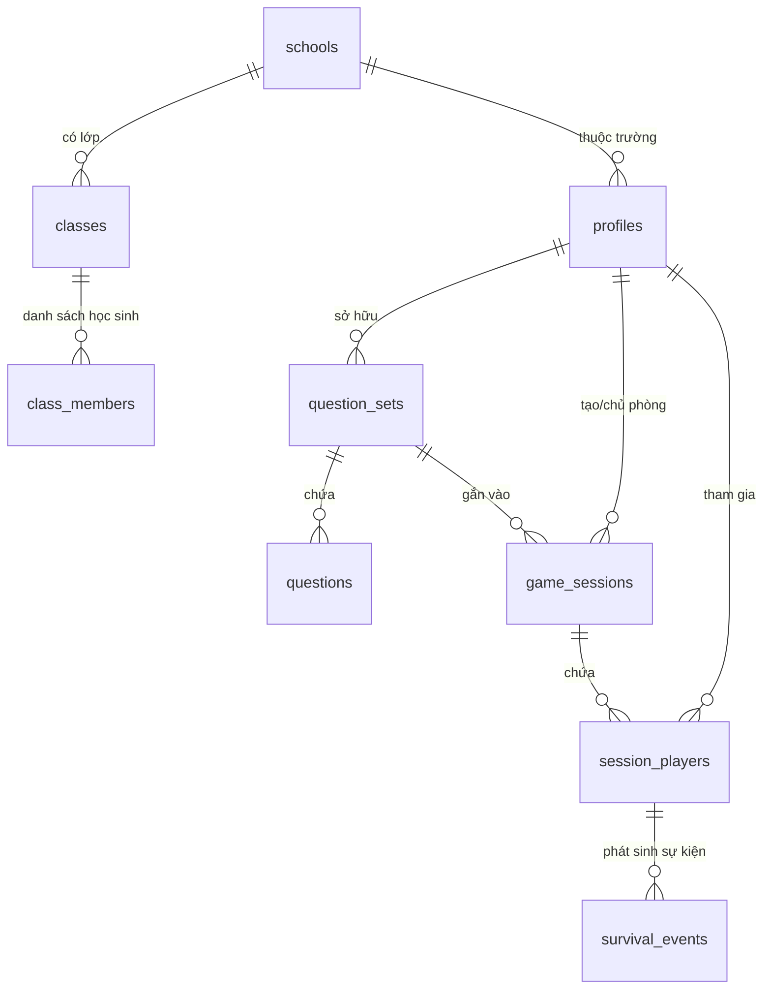

# 🗺️ BẢN ĐỒ ĐỊA HÌNH DỰ ÁN FOGGO (CODEBASE MAP)
> **Mục đích:** Tài liệu điều hướng tức thì cho lập trình viên và AI Agent. Mọi luồng đi, kiến trúc file, bảng cơ sở dữ liệu, phân quyền và cơ chế game đều được định vị sẵn tại đây — không cần dò tìm lại từ đầu.

---

## 1. TỔNG QUAN KIẾN TRÚC (TECH STACK)
- **Framework:** Next.js 16.4.5 (App Router, Turbopack, Server Actions)
- **React:** React 19.3.0
- **Ngôn ngữ:** TypeScript 5
- **Giao diện:** Tailwind CSS 4, Lucide React, Framer Motion
- **Backend / DB:** Supabase (PostgreSQL 15+, Supabase Auth, Row Level Security, Realtime)
- **Cơ chế tính điểm & Game Engine:** 100% Server-side (không để lộ đáp án hay logic chấm ở client)
- **Xử lý Excel:** `xlsx` (SheetJS) đọc/ghi tệp bảng tính `.xlsx`

---

## 2. BẢN ĐỒ ĐIỀU HƯỚNG ROUTE (PAGES & APIS)

| Đường dẫn (Route) | File thực thi | Quyền truy cập | Chức năng chính |
|---|---|---|---|
| `/` | `src/app/page.tsx` | Công khai | Landing page giới thiệu Foggo, CTA vào chơi |
| `/login` | `src/app/(auth)/login/page.tsx` | Công khai | Đăng nhập bằng Email hoặc Tên đăng nhập học sinh |
| `/register` | `src/app/(auth)/register/page.tsx` | Công khai | Đăng ký tài khoản Giáo viên (cần email) |
| `/register/student` | `src/app/(auth)/register/student/page.tsx` | Công khai | Đăng ký Học sinh KHÔNG CẦN EMAIL (User + Pass + Mã khôi phục) |
| `/register/recovery-code` | `src/app/(auth)/register/recovery-code/page.tsx` | Công khai | Hiển thị mã khôi phục bí mật sau khi học sinh đăng ký |
| `/dashboard` | `src/app/dashboard/page.tsx`, `DailyLoginStreakCard.tsx`, `actions.ts` | User đã đăng nhập | Phân quyền: Giáo viên quản trị bộ đề & phòng; Học sinh có Hub Thám Hiểm (Trường, Lớp, Tài nguyên, Điểm danh 7 ngày nhận quà, Bãi Farm Solo 24/7, Đấu trường Lớp, Trang bị & Lịch sử) |
| `/dashboard/sets` | `src/app/dashboard/sets/page.tsx` | Teacher, Admin | Danh sách bộ câu hỏi, Import/Export Excel, Xóa bộ đề (Học sinh bị ẩn) |
| `/dashboard/sets/new` | `src/app/dashboard/sets/new/page.tsx` | Teacher, Admin | Khởi tạo nhanh bộ đề mới (tiêu đề, môn, lớp) |
| `/dashboard/sets/[id]/edit` | `src/app/dashboard/sets/[id]/edit/page.tsx` | Owner, Admin | Trình soạn thảo 8 dạng câu hỏi, Import Excel vào bộ đề, Tải file mẫu |
| `/dashboard/reports/[id]` | `src/app/dashboard/reports/[id]/page.tsx` | Teacher, Admin | Báo cáo chi tiết phòng chơi: xếp hạng, câu hay sai, xuất CSV |
| `/worlds` | `src/app/worlds/page.tsx` | All (phân quyền) | Danh sách hầm ngục đang quản lý & đảo đang tham gia, nút Solo Farm |
| `/teacher/worlds/new` | `src/app/teacher/worlds/new/page.tsx` | Teacher, Admin | Mở hầm ngục mới: chọn bộ đề, chọn đồ hiếm & tỉ lệ rớt (10-100%) |
| `/teacher/worlds/[id]` | `src/app/teacher/worlds/[id]/page.tsx` | Host, Admin | Bảng điều khiển thời gian thực: sương mù, khóa học sinh, bảng điểm |
| `/world/[id]` | `src/app/world/[id]/page.tsx`, `WorldClient.tsx`, `MonsterBattleArena.tsx` | Player | Màn hình sinh tồn tối giản cho học sinh: 4 tab trực quan (Săn Quái, Thợ Rèn & Tiệm Đồ, Túi Đồ & Trang Bị, Bảng Xếp Hạng); lược bỏ rườm rà hái củi/đá/ghép lửa; Đấu trường Săn Quái Bất Tận (hoạt họa nhân vật & quái Slime 8 frames, rút lui trừ máu/rank, boss mở khóa sau 5 mạng quái) |
| `/explore` | `src/app/explore/page.tsx` | User đã đăng nhập | Khám phá kho đề cộng đồng, sao chép 1 chạm vào kho cá nhân |
| `/admin` | `src/app/admin/page.tsx` | Admin | Quản lý Học sinh & Giáo viên: đổi role, cấp mã khôi phục, tặng Đom Đóm |
| `/pricing` | `src/app/pricing/page.tsx` | Công khai | Bảng giá gói Foggo Plus giáo viên / trường học |
| `/j/[token]` | `src/app/j/[token]/page.tsx` | Công khai / Học sinh | Link vào chơi trực tiếp không cần mã PIN qua token |
| `API: /api/world/join` | `src/app/api/world/join/route.ts` | Endpoint | Xử lý học sinh/khách gia nhập phiên chơi bằng token |
| `API: /api/cron/check-expired` | `src/app/api/cron/check-expired/route.ts` | Cron / Webhook | Tự động hạ gói Plus khi hết hạn |

---

## 3. BẢN ĐỒ CƠ SỞ DỮ LIỆU (DATABASE TABLES & RELATIONS)

### Các bảng cốt lõi:
1. **`profiles`**:
   - `id` (uuid, PK, auth.uid)
   - `username` (text, duy nhất cho học sinh đăng ký không email)
   - `display_name` (text, tên hiển thị)
   - `role` (`'student'` \| `'teacher'` \| `'admin'`)
   - `plan` (`'free'` \| `'plus'`)
   - `fireflies` (int, Đom Đóm - tiền tệ ngoài ván lưu vĩnh viễn)
   - `recovery_code_hash` (text, hash bcrypt mã khôi phục học sinh)
2. **`question_sets`**:
   - `id` (uuid, PK)
   - `owner_id` (uuid -> profiles.id)
   - `title`, `description`, `subject`, `grade_level`
   - `visibility` (`'public'` \| `'unlisted'` \| `'private'`)
   - `play_count` (int)
3. **`questions`**:
   - `id` (uuid, PK)
   - `set_id` (uuid -> question_sets.id)
   - `position` (int, thứ tự câu hỏi)
   - `type` (1 trong 8 dạng câu hỏi, xem mục 5)
   - `content` (jsonb, đề bài, các phương án, ảnh minh họa)
   - `answer_key` (jsonb, đáp án đúng - BẢO MẬT, chỉ server đọc)
   - `time_limit_sec` (int, mặc định 20-30s)
   - `points` (int, mặc định 1000)
   - `explanation` (text, lời giải thích sau khi trả lời)
4. **`game_sessions`**:
   - `id` (uuid, PK)
   - `host_id` (uuid -> profiles.id)
   - `teacher_id` (uuid, backup quản lý)
   - `set_id` (uuid -> question_sets.id)
   - `kind` (`'class'` \| `'solo'` \| `'link'`)
   - `status` (`'open'` \| `'paused'` \| `'closed'`)
   - `settings` (jsonb: `dungeonDrops`, `dungeonDropRate`, `isClassDungeon`, `isHomeFarm`, `dailyPlayLimitMinutes`)
5. **`session_players`**:
   - `id` (uuid, PK)
   - `session_id` (uuid -> game_sessions.id)
   - `user_id` (uuid -> profiles.id)
   - `hp`, `max_hp`, `score`, `gold` (tiền vàng trong ván để mua đồ thợ rèn)
   - `inventory` (jsonb: danh sách slot vật phẩm, số lượng, độ bền)
   - `equipment` (jsonb: `{ weapon, armor, accessory }`)
   - `state` (jsonb: `{ hp, hunger, fogLevel, streak, day, phase }`)

---

## 4. BẢN ĐỒ AUTH VÀ PHÂN QUYỀN (AUTHENTICATION & ROLES)
- **Tệp điều phối trung tâm:** `src/lib/auth.ts`
- **Hàm `requireUser(roles?: UserRole[])`:**
  - Kiểm tra session đăng nhập qua cookie server.
  - Tự động nhận diện Superadmin qua email `hoaifongg@gmail.com` hoặc metadata `role=admin` và thăng cấp `admin` + gói `plus`.
  - Quản trị viên (`admin`) tự động có toàn quyền như Giáo viên + Học sinh mà không bao giờ bị chặn 403 / redirect.
- **Tệp đăng nhập/đăng ký:**
  - `src/app/(auth)/actions.ts`: Đăng nhập (hỗ trợ cả username & email), Đăng xuất, Đăng ký GV.
  - `src/app/(auth)/student-actions.ts`: Đăng ký học sinh qua Admin API `admin.auth.admin.createUser`, gán domain nội bộ `@student.foggo.vn`, bypass email confirmation.
- **Biến môi trường (`.env.local`):**
  - `NEXT_PUBLIC_SUPABASE_URL`: Đường dẫn API Supabase.
  - `NEXT_PUBLIC_SUPABASE_ANON_KEY`: Khóa công khai cho client.
  - `SUPABASE_SERVICE_ROLE_KEY`: Khóa Secret quyền Admin tối cao (dùng ở server routes & student actions).

---

## 5. BẢN ĐỒ 9 DẠNG CÂU HỎI (QUESTION TYPES REGISTRY)
- **Thư mục gốc:** `src/question-types/`
- **Tệp đăng ký tổng:** `src/question-types/registry.ts`

| Loại (`type`) | Tên hiển thị | Thư mục định nghĩa | Cấu trúc `content` | Cấu trúc `answer_key` |
|---|---|---|---|---|
| `single_choice` | Trắc nghiệm 1 đáp án | `src/question-types/single-choice/` | `{ prompt, options: [{id, text}] }` | `{ correct: "opt_id" }` |
| `true_false` | Đúng / Sai | `src/question-types/true-false/` | `{ prompt, statements: [{id, text}] }` | `{ answers: { s1: true } }` |
| `multi_select` | Chọn nhiều đáp án đúng | `src/question-types/multi-select/` | `{ prompt, options: [{id, text}] }` | `{ correct: ["opt_1", "opt_3"] }` |
| `dropdown_list` | Lựa chọn từ danh sách | `src/question-types/dropdown-list/` | `{ prompt: "...{D}...", dropdowns: [{id, options}] }` | `{ answers: { d1: "Có" } }` |
| `drag_order` | Kéo thả sắp xếp thứ tự | `src/question-types/drag-order/` | `{ prompt, items: [{id, text}] }` | `{ order: ["id_1", "id_2", ...] }` |
| `drag_match` | Ghép cặp tương ứng | `src/question-types/drag-match/` | `{ prompt, pairs: [{left, right}] }` | `{ pairs: [...] }` |
| `drag_fill` | Kéo từ điền vào chỗ trống | `src/question-types/drag-fill/` | `{ template, words: [] }` | `{ blanks: { b1: "từ" } }` |
| `hotspot` | Điểm nóng trên hình ảnh | `src/question-types/hotspot/` | `{ image_url, regions: [] }` | `{ correct_region_id }` |
| `true_false_multi` | Nhiều mệnh đề Đúng/Sai | `src/question-types/true-false/` (alias) | `{ prompt, statements }` | `{ answers: { s1: true } }` |

---

## 6. BẢN ĐỒ GAME ENGINE SINH TỒN (SURVIVAL ENGINE)
- **Thư mục:** `src/game-modes/survival/`
- **Tệp cốt lõi:**
  - `engine.ts`: Các hàm thuần cập nhật trạng thái game (`tick`, `applyHunt`, `applyFlee`, `applyGather`, `applyExplore`, `applyCraft`, `applyBlacksmithBuy`, `applyNightDefense`, `applyRevive`, `applyRespawn`). Bảo lưu 100% xu của người chơi khi ngất xỉu.
  - `items.ts`: Toàn bộ từ điển vật phẩm (`ITEM_REGISTRY`), vũ khí, giáp, thuốc, và danh sách báu vật hiếm hầm ngục (`DUNGEON_RARE_ITEMS`).
  - `config.ts`: Cân bằng chỉ số thân thiện tân thủ (Slime 20 HP, 3 ATK), đói giảm chậm, bảo lưu 100% xu khi chết (`DEATH_GOLD_KEEP_RATIO: 1.0`).
  - `clock.ts`: Tính toán pha ngày/đêm và ngày thứ mấy dựa trên thời gian thực.
  - `monsters.ts`: Từ điển quái vật theo khu vực, hàm `getRandomFarmMonster()` xuất hiện quái ngẫu nhiên liên hoàn.
  - `src/app/world/[id]/MonsterBattleArena.tsx`: Đấu trường 2D RPG Single-Screen Viewport (`h-screen overflow-hidden`, không cần cuộn dọc) — sân đấu quái nhỏ gọn phía trên (180px–210px), hoạt họa nhân vật & Sprite Slime 8 frames, câu hỏi & đáp án 2 cột dàn trải đều bên dưới, nút vung kiếm kèm phím tắt Enter, hiển thị Xu an toàn (`Number.isFinite`) và popup cấp cứu sinh lực khi hết máu (mua bình máu 10 xu, dùng item túi đồ, hồi sinh trại miễn phí).
  - `src/components/DailyLoginStreakCard.tsx`: Bảng điểm danh đăng nhập 7 ngày nhận quà liên tiếp trên Dashboard học sinh; cấu hình phần thưởng tách biệt tại `src/lib/daily-rewards-config.ts`, server action tại `src/app/dashboard/actions.ts`.

### Quy luật 2 chế độ (Class Dungeon vs Home Farm):
1. **Hầm ngục lớp (`isClassDungeon = true`):**
   - GV chọn danh sách đồ rơi hiếm (`dungeonDrops`) và chỉnh tỉ lệ (`dungeonDropRate`).
   - Săn quái rớt đồ hiếm theo xác suất do GV định trước.
   - Bảng xếp hạng và sự kiện chung toàn lớp.
2. **Farm quái tại nhà (`isHomeFarm = true`, `kind = 'solo'`):**
   - Tự động lấy ngẫu nhiên câu hỏi từ Giáo viên của Lớp và Trường học sinh đang theo học (`profiles.class_id`, `profiles.school_id`).
   - Săn quái theo lượt (Turn-based RPG): Trả lời đúng -> Tấn công quái. Nếu quái chưa chết -> Quái phản công học sinh (sát thương được giảm nhờ Mũ, Giáp, Khiên tối đa 60%).
   - Học sinh cày Vàng và Đom Đóm khi GV chưa mở phòng lớp.
   - Tiêu Vàng tại Thợ Rèn & Tiệm Đồ để sắm Kiếm, Mũ, Giáp Sắt, Khiên và Nhu yếu phẩm/Thuốc.
   - Vàng và Trang bị lưu vĩnh viễn mang vào Hầm ngục lớp học.

### Chỉ số cân bằng RPG & Chống lạm phát (Game Balance):
- **Nhân vật:** HP: 100, Đói: 100, ATK cơ bản (tay không): 8, Vàng khởi đầu: 30 xu.
- **4 Ô Trang Bị (`EquippedGear`):**
  - ⚔️ **Vũ khí (`weapon`):** Gậy gỗ (+4 ATK), Kiếm gỗ (+6 ATK), Kiếm đá (+10 ATK), Kiếm sắt (+15 ATK). Có thể cường hóa +4 ATK/cấp.
  - 🪖 **Mũ (`helmet`):** Mũ rơm (-3% ST), Mũ da (-6% ST), Mũ sắt (-10% ST).
  - 🛡️ **Giáp (`armor`):** Áo vải (-5% ST), Giáp da (-10% ST), Giáp sắt (-18% ST).
  - 🛡️ **Khiên (`shield`):** Khiên gỗ (-6% ST), Khiên sắt (-12% ST).
  *(Tổng phòng thủ Giáp + Mũ + Khiên tối đa 60% giảm sát thương, giữ nguyên độ kịch tính khi săn quái).*
- **Nhu yếu phẩm & Thức ăn:** Táo (+15 đói, +3 HP), Bánh mì (+30 đói, +6 HP), Thịt nướng (+45 đói, +12 HP), Băng gạc (+25 HP), Bình máu nhỏ (+40 HP), Bình máu lớn (+75 HP).
- **Quái vật cơ bản (Forest):**
  - `slime` (30 HP, 5 ATK, 3-6 xu)
  - `baby_wolf` (40 HP, 6 ATK, 5-8 xu)
  - `wolf` (55 HP, 8 ATK, 7-12 xu)
  - `mist_spider` (48 HP, 10 ATK, 7-12 xu)
  - `wild_boar` (65 HP, 9 ATK, 8-14 xu)
  - `forest_goblin` (80 HP, 12 ATK, 12-18 xu)
  - Boss `boar_king` (200 HP, 16 ATK, 70-110 xu)

---

## 7. BẢN ĐỒ CHỨC NĂNG SAO LƯU & NHẬP XUẤT CÂU HỎI (EXCEL IMPORT/EXPORT)
- **Xử lý Excel:** `src/lib/excel/`
  - `template.ts`: Tạo file mẫu Excel chuẩn `.xlsx` (kèm hướng dẫn, tô màu header, câu mẫu có sẵn).
  - `importer.ts`: Đọc file Excel từ giáo viên tải lên, phân tích cú pháp, tự động nhận diện dạng câu hỏi và chuẩn hóa schema.
  - `exporter.ts`: Xuất bộ câu hỏi ra file `.xlsx` hoặc `.json` sao lưu an toàn.
- **Giao diện tích hợp:**
  - `src/app/dashboard/sets/page.tsx`: Nút "Tải file mẫu Excel", "Nhập đề từ Excel", "Sao lưu bộ đề".
  - `src/app/dashboard/sets/[id]/edit/QuestionSetEditorClient.tsx`:
    - Thanh cuộn độc lập cho danh sách câu hỏi bên trái (`overflow-y-auto`, không kéo dài màn hình).
    - Bảo lưu 100% nội dung câu hỏi (`prompt`), hình ảnh và phương án/mệnh đề tương thích khi người dùng chuyển đổi dạng câu hỏi (`handleChangeType`).

---

## 8. NGUYÊN TẮC VÀ LỐI TẮT BẢO TRÌ NHANH
1. **Sửa giao diện / thanh Header:** vào thẳng [`src/components/NavigationHeader.tsx`](file:///d:/Project/Foggo/src/components/NavigationHeader.tsx).
2. **Sửa trang quản trị Admin:** vào thẳng [`src/app/admin/AdminClient.tsx`](file:///d:/Project/Foggo/src/app/admin/AdminClient.tsx).
3. **Sửa trang tạo hầm ngục mới:** vào thẳng [`src/app/teacher/worlds/new/NewWorldClient.tsx`](file:///d:/Project/Foggo/src/app/teacher/worlds/new/NewWorldClient.tsx).
4. **Sửa trang Dashboard:** vào thẳng [`src/app/dashboard/page.tsx`](file:///d:/Project/Foggo/src/app/dashboard/page.tsx).
5. **Thêm vật phẩm hoặc chỉnh tỉ lệ rơi:** vào [`src/game-modes/survival/items.ts`](file:///d:/Project/Foggo/src/game-modes/survival/items.ts) và [`engine.ts`](file:///d:/Project/Foggo/src/game-modes/survival/engine.ts).
6. **Bảo mật cơ sở dữ liệu & RLS:** Khi thao tác server actions liên quan đến `session_players`, `game_sessions`, sử dụng `createAdminClient()` từ `@/lib/supabase/admin` để tránh lỗi `new row violates row-level security policy for table "session_players"`.
7. **Kiểm thử logic:** chạy lệnh `npm test` (kiểm tra 52 bài unit test của game engine và chấm điểm).
8. **Kiểm tra biên dịch:** chạy lệnh `npm run build` (kiểm tra toàn bộ 21 trang và TypeScript).
9. **Đấu trường săn quái 2D & Bố cục Single-screen:** Xem [`src/app/world/[id]/MonsterBattleArena.tsx`](file:///d:/Project/Foggo/src/app/world/[id]/MonsterBattleArena.tsx) - gom trọn sân đấu quái và bảng câu hỏi trong `h-screen overflow-hidden`, hiển thị Xu an toàn bằng `Number.isFinite(...)` không gây lỗi `NaN`.
10. **Cấu hình Đăng nhập 7 ngày nhận quà:** Đặt tại [`src/lib/daily-rewards-config.ts`](file:///d:/Project/Foggo/src/lib/daily-rewards-config.ts) (không để trong file `"use server"` để tránh lỗi Turbopack `DAILY_REWARDS_CONFIG.map is not a function`).
11. **Tối giản trải nghiệm học sinh (UX Streamlining):** Toàn bộ giao diện học sinh được tinh gọn: thanh Header chỉ hiện 2 tab cần thiết (Tổng quan, Hầm ngục); Dashboard hiển thị ngay Trường/Lớp, Vàng, Điểm Thành Tích, Điểm danh 7 ngày và 2 nút chơi lớn; Màn chơi thế giới chỉ giữ 4 tab RPG quan trọng (Săn Quái, Thợ Rèn, Túi Đồ, Bảng Xếp Hạng), lược bỏ toàn bộ cơ chế hái lượm cành cây và chế lửa rườm rà.
12. **Tiêu chuẩn thiết kế giao diện chuyên nghiệp (Google / Big Tech + Retro Pixel Art):** Tích hợp tiện ích CSS `.pixelated`, `.pixel-card`, `.glow-amber/emerald/blue` tại `src/app/globals.css`. Nâng cấp toàn diện Landing Page (`src/app/page.tsx`) với mockup sân đấu RPG trực quan sống động (nhân vật thám hiểm, pixel slime sprite, streak bonus, mẫu câu trắc nghiệm); Nâng cấp thanh Navigation Header (`src/components/NavigationHeader.tsx`) chuẩn SaaS hiện đại với pill tabs, avatar chip, role indicator dot; Nâng cấp thẻ điểm danh 7 ngày (`DailyLoginStreakCard.tsx`) với thanh tiến độ tuần và hiệu ứng rương VIP ngày 7; Nâng cấp bảng xếp hạng vinh danh với huy chương 🥇 Top 1, 🥈 Top 2, 🥉 Top 3 và thẻ săn quái bounty cards trong `WorldClient.tsx`.
13. **Tài khoản kiểm thử thực chiến (Test Accounts):** Toàn bộ thông tin tài khoản Học sinh (`hocsinh_test` / `TestPassword123!`) và Giáo viên (`giaovien_test@foggo.vn` / `TestPassword123!`) được lưu trữ vĩnh viễn tại [`TEST_ACCOUNTS.md`](file:///d:/Project/Foggo/TEST_ACCOUNTS.md). Kịch bản tự động kiểm thử gameplay và đồng bộ DB: `npx tsx scripts/test-account-runner.ts`.
14. **Khắc phục truy vấn liên kết PostgREST trong Bảng Quản Trị Admin (`/admin`):** Bảng `profiles` có 2 khóa ngoại trỏ tới bảng `schools` (`school_id` và `schools.created_by`). Do đó truy vấn Supabase bắt buộc phải chỉ định rõ tên cột khóa ngoại: `.select("*, schools:school_id(name), classes:class_id(name)")` tại [`src/app/admin/page.tsx`](file:///d:/Project/Foggo/src/app/admin/page.tsx) để tránh lỗi `PGRST201 (Could not embed because more than one relationship was found)`, giúp toàn bộ danh sách Giáo viên, Học sinh và Trường học hiển thị đầy đủ, chính xác.

